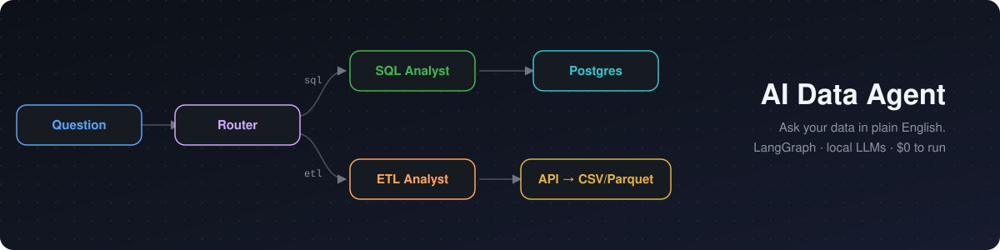
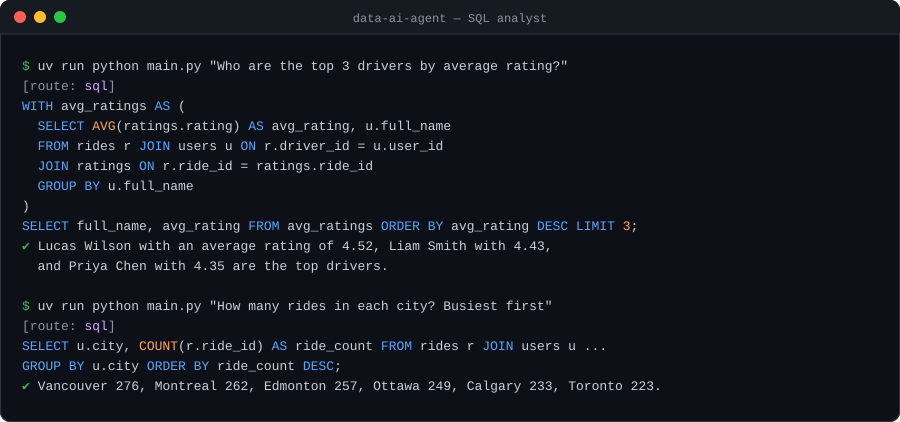
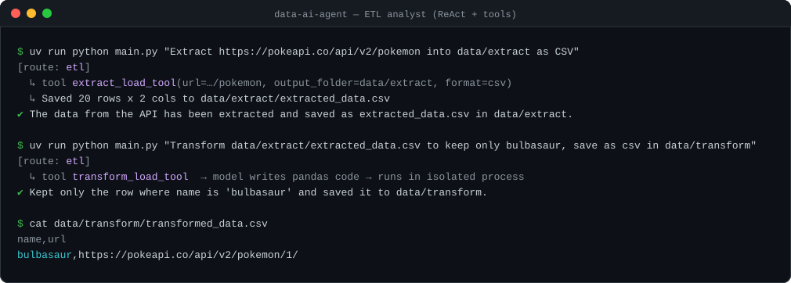
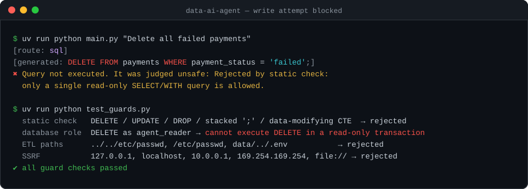
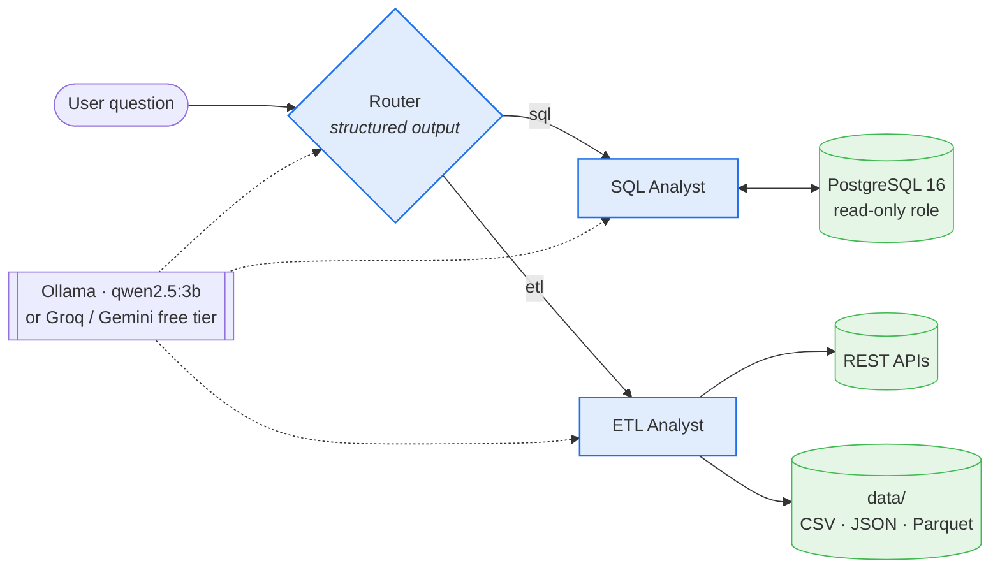
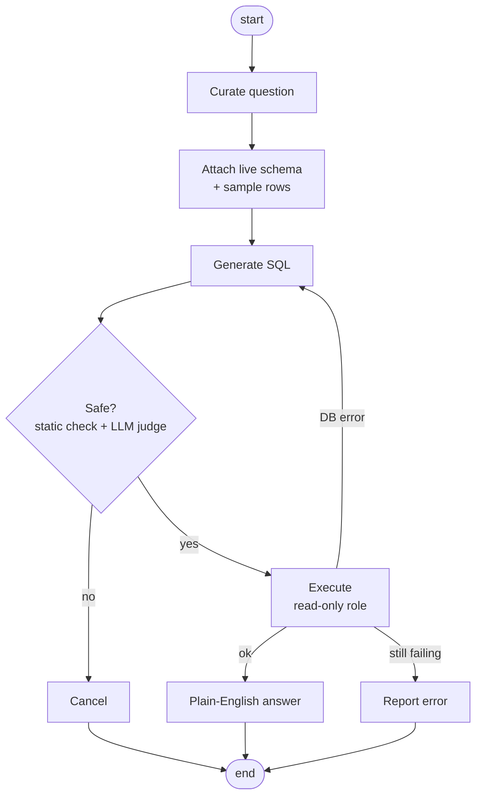
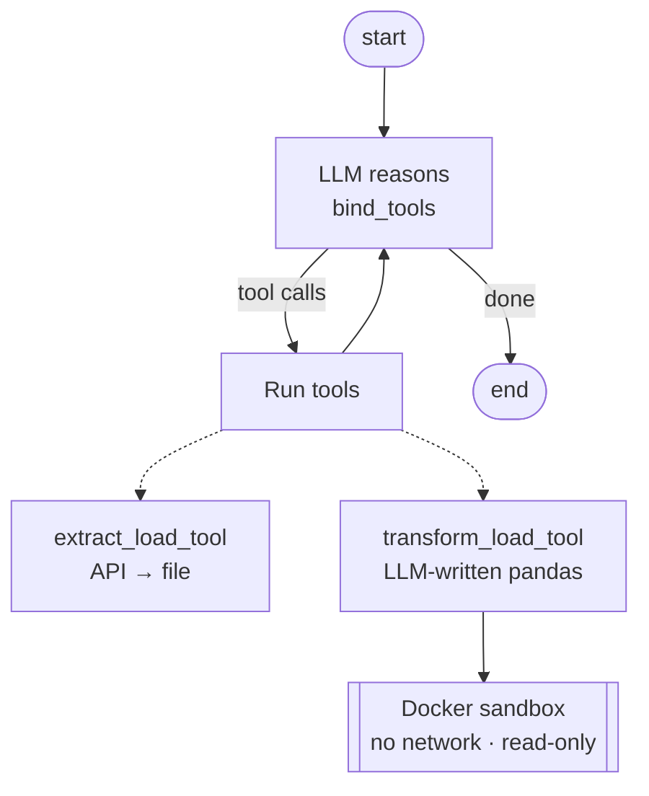
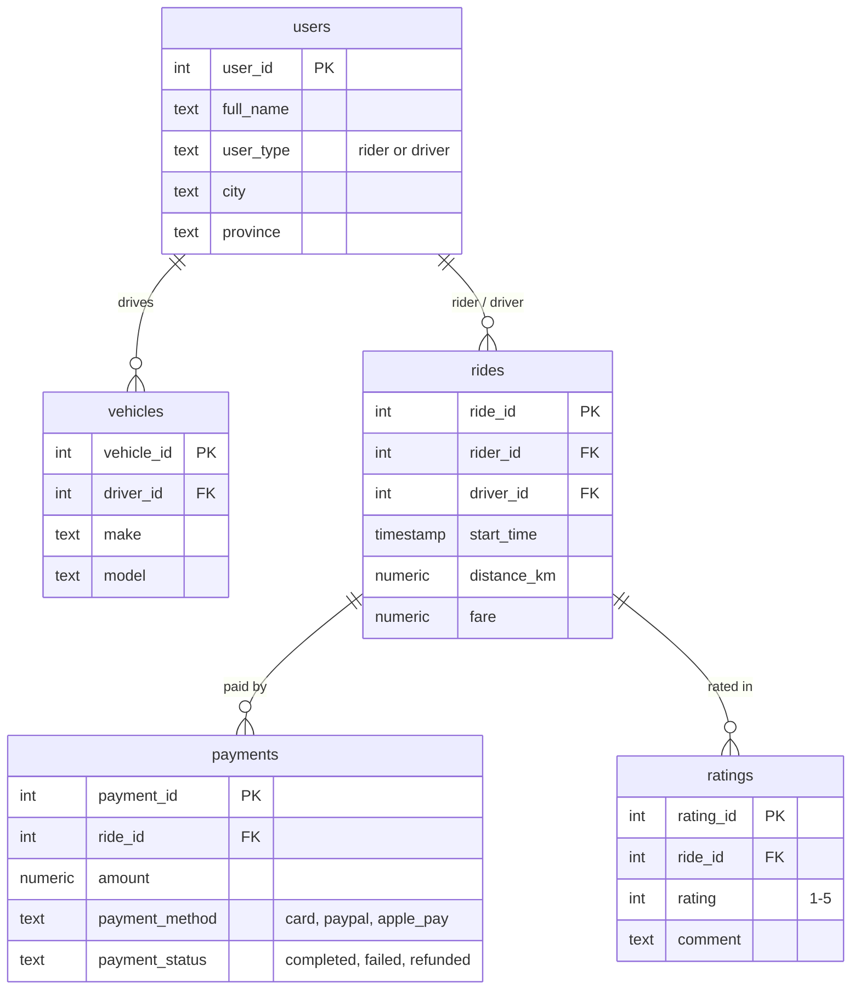

<p align="center">
  
</p>

<p align="center">
  
  
  
  
  
  
</p>

# AI Data Agent

**Ask your data questions in plain English.** A LangGraph multi-agent system with a router that sends each request to the right specialist:

- **SQL Analyst:** turns a question into PostgreSQL, checks that the query is read-only, runs it, and answers in plain English. If the query fails, it reads the error and fixes the query.
- **ETL Analyst:** a ReAct agent with tools that pulls data from REST APIs into CSV, JSON or Parquet, and transforms files with pandas code that it writes itself.

Everything runs locally on **free, open models through Ollama**, with Postgres in Docker. There are no API keys and no cloud bill.

---

## See it in action

<p align="center"></p>

<p align="center"></p>

<p align="center"></p>

---

## Architecture



<table>
<tr>
<th width="58%">SQL Analyst: pipeline with a safety gate and self-repair</th>
<th>ETL Analyst: ReAct loop</th>
</tr>
<tr>
<td>



</td>
<td>



</td>
</tr>
</table>

<details>
<summary><b>Sample database: ride-share (200 users · 40 vehicles · 1,500 rides · payments · ratings)</b></summary>



The data is synthetic and deterministic, generated in SQL by `init/02-sample-data.sql` with no CSV files.
</details>

---

## Quick start

**You need:** Python 3.12, [uv](https://docs.astral.sh/uv/), Docker and [Ollama](https://ollama.com).

```bash
git clone https://github.com/sharpsailor/data-ai-agent.git && cd data-ai-agent
cp .env.example .env
uv sync
docker compose up -d --wait        # Postgres on :5437 (auto-seeded) + Adminer on :8080
ollama pull qwen2.5:3b             # ~1.9 GB, runs on a 4 GB GPU or on CPU
# the pandas sandbox image (Dockerfile.sandbox) builds automatically on the first transform

uv run python main.py "What is the average fare by city?"
uv run python main.py              # interactive mode
```

| Command | What it does |
|---|---|
| `uv run python main.py "<question>"` | Ask one question |
| `uv run python main.py --graphs` | Print the compiled LangGraph graphs as Mermaid |
| `uv run python test_guards.py` | Safety checks with no LLM: SQL guard, read-only role, path confinement, SSRF, sandbox escape attempts, and planted symlinks or FIFOs |
| `uv run python smoke_test.py` | 5 end-to-end scenarios against the real LLM and database |

To browse the data, open http://localhost:8080 and log in with system `PostgreSQL`, server `db`, user `agent_user`, password `agent_pass` and database `agent_db`.

### Try asking

| Request | Route | What happens |
|---|---|---|
| *What are the different payment methods?* | `sql` | `SELECT DISTINCT payment_method …` → plain-English answer |
| *Who are the top 3 drivers by average rating?* | `sql` | CTE + 3-table join + `ORDER BY … LIMIT 3` |
| *Delete all failed payments* | `sql` | Blocked by the safety gate; nothing is executed |
| *Extract https://pokeapi.co/api/v2/pokemon into data/extract as CSV* | `etl` | Writes `data/extract/extracted_data.csv` |
| *Transform data/extract/extracted_data.csv to keep only bulbasaur, save as csv in data/transform* | `etl` | The LLM writes pandas code, which runs in a Docker sandbox |

---

## Models: free either way

Each tier is one line in `.env` (`provider:model`). Any LangChain chat model works, through `init_chat_model`.

| Option | Setting | Notes |
|---|---|---|
| **Local Ollama** *(default)* | `ollama:qwen2.5:3b` | Free and offline. Passes 5/5 of the smoke test. |
| Groq free tier | `groq:llama-3.3-70b-versatile` + `GROQ_API_KEY` | Much faster and more accurate. Run `uv sync --extra groq`. |
| Gemini free tier | `google_genai:gemini-2.5-flash` + `GOOGLE_API_KEY` | Run `uv sync --extra gemini`. |

There are two tiers: `LLM_BASIC` handles routing, rewording and summaries, and `LLM_ADVANCED` handles SQL, the safety judge, tool use and code generation. Point them at different models to balance cost and quality.

> Local 3B models take about 15–60 s per request on a 4 GB GPU and sometimes write imperfect SQL. Switching to a free 70B model on Groq is the easiest upgrade. Of the local models tested, `llama3.2` passed 4/5, and `qwen2.5-coder` cannot make native tool calls.

---

## Security

The agent runs code and SQL written by a model, so it's built on the assumption that the model will sometimes get things wrong.

| Layer | Protection |
|---|---|
| **SQL: static check** | Only a single `SELECT`/`WITH` statement. Write keywords, stacked `;` and data-modifying CTEs are rejected. |
| **SQL: LLM judge** | A second model reviews the query and explains any rejection. |
| **SQL: database role** | `agent_reader` has `SELECT` only, plus `default_transaction_read_only` and a 10 s `statement_timeout`. **This is the actual guarantee.** |
| **Files** | ETL tools can only read and write inside `data/`. Absolute paths, `../` and symlink escapes are rejected. |
| **Network** | Extraction allows only http(s) to public IPs. Loopback, private ranges, cloud metadata and redirects are refused. |
| **Generated code** | Runs in a throwaway **Docker sandbox**: `--network none`, read-only root filesystem, only `data/` mounted, no host environment or secrets, non-root user, all capabilities dropped, `no-new-privileges`, and limits of 512 MB memory, 1 CPU, 128 processes and 60 s (then killed). If Docker isn't available, the transform refuses to run. The file preview is labelled as untrusted data in the prompt. |
| **Agent loop** | The ETL reason/act loop is capped by `recursion_limit`. |

> `test_guards.py` attempts real escapes from inside the sandbox and expects every one to fail: reaching the internet, reaching the host database, reading the project `.env` or `~/.ssh` keys, writing to the root filesystem, reading host environment variables, running an infinite loop, and leaving a symlink or FIFO in `data/` for the host to write through later (the host writes to a fresh temp file and swaps it into place, so it never follows a link). The remaining exposure is the `data/` folder, which the code is meant to work on.
>
> Not covered: the extract tool checks a URL's address once, then connects, so a hostile domain could switch to an internal address in between (DNS rebinding). Pin the connection to the checked IP before letting untrusted users submit URLs.

---

## Project structure

```
agents/
  data_agent.py     router graph (structured-output RouterSchema)
  sql_analyst.py    SQL pipeline: curate → schema → generate → judge → execute → answer (+ retry)
  etl_analyst.py    ReAct loop over extract_load_tool / transform_load_tool
models/schema.py    Pydantic graph state + structured-output schemas
utils/
  llm_pick.py       tier → chat model (any provider via init_chat_model)
  database.py       schema-to-text for prompts, read-only query execution, SQL static check
  etl_tools.py      API → CSV/JSON/Parquet, file preview, path + SSRF guards, Docker sandbox runner
init/               schema, read-only role, synthetic seed data
Dockerfile.sandbox  pinned pandas/pyarrow image for generated code
assets/             README images
```

## Design decisions

- **A graph of small steps over typed state.** Each node does one job and returns only the fields it changes, so every step can be tested and inspected on its own.
- **Structured output instead of parsing text.** The router and the safety judge return Pydantic `Literal` values, so the graph branches on a type rather than on whatever text the model produces.
- **Live schema in the prompt.** Columns, types and 5 sample rows per table are read from `information_schema` at query time, so pointing the agent at a different database needs no code change.
- **Self-repair.** When a query fails, the database error goes back to the SQL generator for one retry before the agent gives up cleanly.
- **Model tiering.** Cheap, fast models handle classification and summaries; stronger models are used only where code is written.
